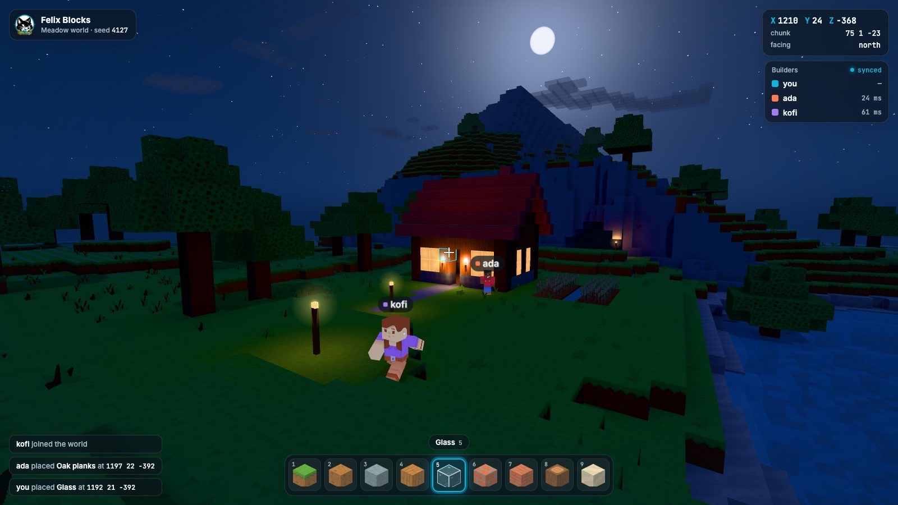

# Felix Blocks

A voxel building game for the browser, alone or with friends, whose only
backend is [Felix](https://github.com/GetFelix/felix).

Felix Blocks is a first-person world of blocks that you dig and build in. You
can play alone, open your world to friends and build together, or let people
visit without being able to change anything. There is no game server: the
browsers write the world, and Felix stores it, orders the writes and tells
everyone what changed.

> **Status:** design stage. The [style frame](prototype/style-frame.html) shows
> the look, day and night; nothing is playable yet. The plan is in
> [docs/design.md](docs/design.md) and the work is tracked in
> [milestones](https://github.com/GetFelix/felix-blocks/milestones).

| Day | Night |
|---|---|
|  |  |

## What it shows about Felix

[felix-arena](https://github.com/GetFelix/felix-arena) uses a log as a live feed
and a replay, and [felix-metro](https://github.com/GetFelix/felix-metro) seeks
back through a long history. Felix Blocks is about keyed state that many people
change at once:

- **Concurrent edits resolve cleanly.** Two players digging in the same chunk
  at the same moment both keep their blocks. Each write is conditional on the
  version the client last saw, so the second one is refused and rebased, never
  applied over the first.
- **You see the world as soon as you join.** A retained cache watch delivers
  every edited chunk around you, then each change as it lands.
- **Storage is what was built.** Untouched terrain is generated from the seed
  and never stored, and compaction keeps the world at its current blocks no
  matter how many edits it has seen.
- **Solo and shared worlds are the same thing.** Opening your world to a friend
  is a grant, not an export.
- **Felix enforces permissions.** A visitor's browser cannot change a world,
  whatever it sends.

## What you will be able to do

- Walk around a world generated from a seed, dig blocks out and place new ones
- Play alone in a private world that is saved in Felix and opens on any device
- Open that world to friends and build together, seeing each other and each other's blocks as they land
- Dig in the same spot as someone else at the same moment without either of you losing a block
- Let people visit a world without being able to change it
- Try it offline, with no server at all

## Felix features it uses

| Need | Felix feature |
|---|---|
| The world, one value per chunk | A log-backed cache |
| Two players editing one chunk | Conditional writes (`cache_put_if` at the version read) |
| Seeing the world on join, then every change | A retained cache watch |
| Catching up after a dropped connection | Resuming a watch from an offset |
| The world stays the size of what is built | Cache compaction |
| Where everyone is | An in-memory stream |
| Who is online | A cache with a TTL |
| Builders and visitors | RBAC on the world's cache |
| Browsers | [felix-gateway](https://github.com/GetFelix/felix-gateway) |

Some of these are not yet reachable through the gateway. The biggest is
conditional writes, which multiplayer needs
([felix-gateway#31](https://github.com/GetFelix/felix-gateway/issues/31)). The
design lists the rest under "Felix gaps", and each one has an issue labelled
[`felix-gap`](https://github.com/GetFelix/felix-blocks/labels/felix-gap).

## How it works

A world is split into chunks of 16 × 16 × 16 blocks. Every client generates
the terrain from the world's seed, so a chunk nobody has touched is not stored
anywhere. A chunk somebody changed is one key in the world's Felix cache,
holding its difference from the generated terrain.

To place a block, the client writes the chunk's new value only if the chunk is
still at the version it last saw. If someone else got there first, the write
is refused, the client takes their version, puts its own change on top and
tries again. Every client watches the chunks around it, so changes show up for
everyone as they land. Player positions go on an in-memory stream ten times a
second. [docs/design.md](docs/design.md) has the details.

## Status

| M | Milestone | What it proves | State |
|---|---|---|---|
| 0 | The look, locked | It looks good, day and night, before Felix is involved | In progress: style frame done |
| 1 | A world you can edit, solo | Your world is saved in Felix and opens anywhere | Planned |
| 2 | Multiplayer | Two players in one chunk never overwrite each other | Planned, needs conditional writes in the gateway |
| 3 | A world that lasts | Compaction keeps the world at its current blocks; rejoin picks up where you left | Planned |
| 4 | Worlds with owners | Builders and visitors, enforced by Felix | Planned |
| 5 | Region watches | Joining costs what you can see, not the whole world | Planned |
| 6 | Scale and failover | 50 players, broker restarts and failover | Planned |
| 7 | Self-hosting | Anyone can run it | Planned |

## Documentation

- [docs/design.md](docs/design.md): the design, data model and build order
- [docs/art.md](docs/art.md): art direction, day and night, the asset packs and the style frame
- [Felix docs](https://docs.getfelix.dev/)

## Contributing

See [CONTRIBUTING.md](CONTRIBUTING.md).

## License

MIT. See [LICENSE](LICENSE).
