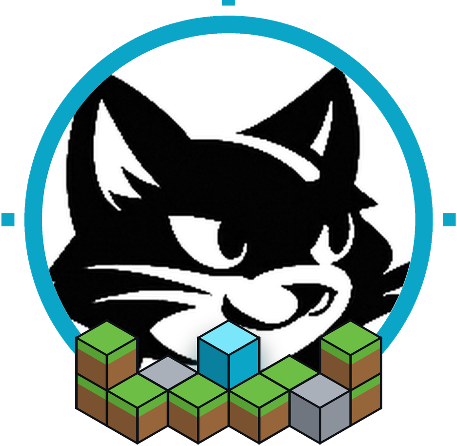
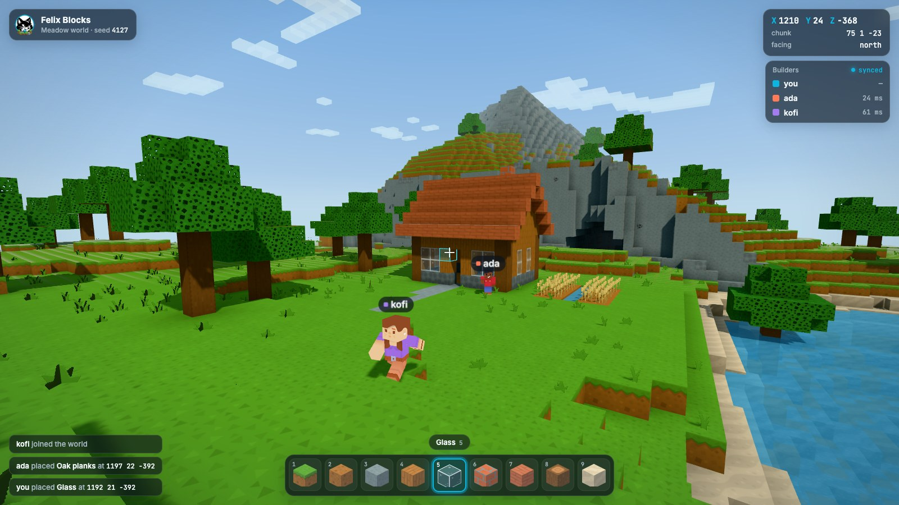
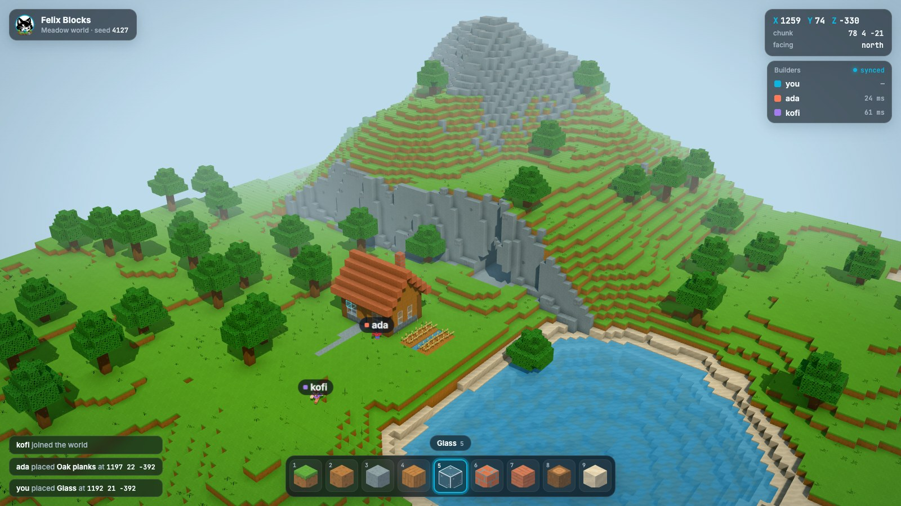

# Felix Blocks

A voxel building game for the browser, alone or with friends, whose only
backend is [Felix](https://github.com/GetFelix/felix).

> **Status:** design stage. The [style frame](prototype/style-frame.html) shows the look; nothing is playable yet. The plan is in
> [docs/design.md](docs/design.md) and the work is tracked in
> [milestones](https://github.com/GetFelix/felix-blocks/milestones).

| First person | Overview |
|---|---|
|  |  |

## What you will be able to do

- Walk around a world generated from a seed, dig blocks out and place new ones
- Play alone in a private world that is saved in Felix and opens on any device
- Open that world to friends and build together, seeing each other and each other's blocks as they land
- Dig in the same spot as someone else at the same moment without either of you losing a block
- Let people visit a world without being able to change it
- Try it offline, with no server at all

## Felix features it uses

| Need | Felix feature |
|---|---|
| The world, one value per chunk | A log-backed cache |
| Two players editing one chunk | Conditional writes (`cache_put_if` at the version read) |
| Seeing the world on join, then every change | A retained cache watch |
| Catching up after a dropped connection | Resuming a watch from an offset |
| The world stays the size of what is built | Cache compaction |
| Where everyone is | An in-memory stream |
| Who is online | A cache with a TTL |
| Builders and visitors | RBAC on the world's cache |
| Browsers | [felix-gateway](https://github.com/GetFelix/felix-gateway) |

Some of these are not yet reachable through the gateway. The design lists
them under "Felix gaps", and each one has an issue labelled
[`felix-gap`](https://github.com/GetFelix/felix-blocks/labels/felix-gap).

## How it works

A world is split into chunks of 16 × 16 × 16 blocks. Every client generates
the terrain from the world's seed, so a chunk nobody has touched is not stored
anywhere. A chunk somebody changed is one key in the world's Felix cache,
holding its difference from the generated terrain.

To place a block, the client writes the chunk's new value only if the chunk is
still at the version it last saw. If someone else got there first, the write
is refused, the client takes their version, puts its own change on top and
tries again. Every client watches the chunks around it, so changes show up for
everyone as they land. Player positions go on an in-memory stream ten times a
second. [docs/design.md](docs/design.md) has the details.

## Status

| M | Milestone | State |
|---|---|---|
| 0 | The look, locked | Planned |
| 1 | A world you can edit, solo | Planned |
| 2 | Multiplayer | Planned |
| 3 | A world that lasts | Planned |
| 4 | Worlds with owners | Planned |
| 5 | Region watches | Planned |
| 6 | Scale and failover | Planned |
| 7 | Self-hosting | Planned |

## Documentation

- [docs/design.md](docs/design.md): the design, data model and build order
- [docs/art.md](docs/art.md): art direction, the asset packs and the style frame
- [Felix docs](https://docs.getfelix.dev/)

## Contributing

See [CONTRIBUTING.md](CONTRIBUTING.md).

## License

MIT. See [LICENSE](LICENSE).
