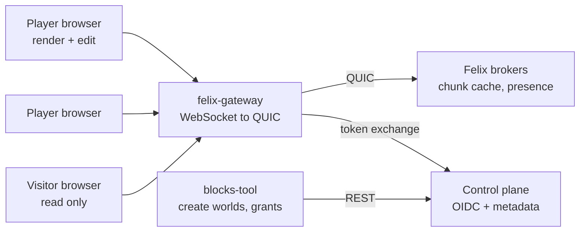

# Felix Blocks design

A voxel building game that runs in the browser, alone or with friends, whose
only backend is [Felix](https://github.com/GetFelix/felix). You walk around a
generated world, dig blocks out and place new ones, and everyone in the same
world sees each change as it lands. The world is stored in a Felix log-backed
cache, one key per chunk, so it survives every restart and stays the size of
what has been built, not the size of everything that ever happened.

[felix-arena](https://github.com/GetFelix/felix-arena) shows a log as the live
feed and the replay. [felix-metro](https://github.com/GetFelix/felix-metro)
shows seeking back through a long history. Felix Blocks shows the other half
of Felix: keyed state that many writers change concurrently, that clients
watch by region, and that compacts down to its current value.

**In scope**

- Worlds generated from a seed: terrain, water, caves and trees
- Digging and placing blocks from a small palette, in first person
- Single player worlds that are private, durable, and can later be opened to friends
- Multiplayer: other players drawn where they are, with names, and their edits showing up live
- Joining a world and seeing its current state at once, from any device
- Worlds with builders and visitors: who may edit and who may only look
- An offline mode with no Felix at all, for trying the game

**Out of scope**

- Survival mechanics: health, hunger, mobs, crafting recipes, inventories beyond a block palette
- Redstone or any block that runs logic
- Physics beyond walking, jumping and simple collision. Sand does not fall, water does not flow
- Infinite worlds. A world has a fixed size (see [Data model](#data-model))
- Anything that needs a second datastore or a game server. If a feature cannot be expressed in Felix caches, streams and counters reached through felix-gateway, it is out

## What it has to demonstrate

1. **Concurrent edits resolve cleanly.** Two players digging in the same chunk at the same moment both see both changes, and neither overwrites the other.
2. **Join and see the world at once.** A player joining a world gets every edited chunk around them in one round trip, and draws the first frame in under two seconds.
3. **An untouched world costs nothing.** Storage grows with the blocks people changed, not with the world's size or the number of edits.
4. **Compaction keeps the world at current state.** After a million edits to a small area, the stored world is the size of that area's current blocks.
5. **Solo and shared worlds are the same thing.** A single player world is a world with one grant holder. Opening it to a friend is a grant, with no export or copy.
6. **Permissions are enforced by Felix.** A visitor's browser cannot change a world, whatever it sends.

## Architecture



| Component | Language | Holds state? | Responsibility |
|---|---|---|---|
| Client | TypeScript, Three.js, `core` as WebAssembly | A view of the chunks around the player | Generate terrain, apply stored chunk edits, mesh, render, edit, presence |
| Gateway | [felix-gateway](https://github.com/GetFelix/felix-gateway) | No | Browser transport, token narrowing to one world, write limits |
| Brokers | Felix | Yes, authoritative | The chunk cache, the presence stream, the online list |
| Control plane | Felix | Yes, metadata | Token exchange, world resources, roles |
| `blocks-tool` | Rust, `core` + control plane REST | No | Create a world's caches and streams, grant builders and visitors, inspect and export a world |

There is no game server. The browsers write the world, Felix stores and
orders it, and the gateway decides which world a browser may reach.

### Shared rules in `core`

World generation from a seed, the block table, the chunk encoding, meshing and
the key scheme live in one Rust crate with no I/O. The browser loads it as
WebAssembly and `blocks-tool` links it natively, as in felix-arena and
felix-metro. Generation uses integer noise so the native and WebAssembly builds
produce the same blocks bit for bit; a stored edit only means something if
every client generates the same chunk underneath it.

## Data model

### Worlds and chunks

- A **block** is one byte, an index into the block table (air, grass, dirt, stone, sand, water, wood, leaves, planks, glass, and a few coloured blocks, up to 256).
- A **chunk** is 16 × 16 × 16 blocks, 4,096 bytes uncompressed.
- A **region** is 8 × 8 chunks across and the full world height, 128 × 128 blocks.
- A **world** is 32 × 32 regions across (4,096 × 4,096 blocks) and 16 chunks (256 blocks) tall. Its name and seed are fixed when it is created.

**Why 16³ chunks and not 32³.** A chunk is the unit of a conditional write, so
it is also the unit of contention: two players a few blocks apart should not
usually be racing for the same key. A 32³ chunk holds eight times the blocks
and is eight times as likely to collide. Size matters too: a dense 32³ chunk is
32 KiB raw, half the gateway's default 64 KiB payload limit before a header or
a second byte per block. A 16³ chunk tops out at 4 KiB. The
cost of the smaller chunk is more keys and more meshes, which greedy meshing
and a bounded view distance keep cheap.

### Only edits are stored

A chunk that nobody has changed has no key. Its blocks come from the seed. A
chunk somebody has changed stores its **delta from the generated chunk**, and
a client draws it by generating the chunk and applying the delta.

The delta has two encodings and the writer picks the smaller:

| Encoding | Layout | Size |
|---|---|---|
| Sparse | count, then `(cell index u16, block u8)` per changed cell | 3 bytes per changed cell |
| Dense | the full 4,096 cells, run-length encoded | 4,096 bytes at worst, usually a few hundred |

Sparse wins below about 1,360 changed cells, which covers almost every chunk
in a normal world. A typical edited chunk (a house, a dug tunnel) changes 100
to 400 cells and stores 300 bytes to 1.2 KiB. The value also carries a format
byte and the generator version, so a world made by an older generator can be
recognised and kept on it.

### One value per chunk, not one record per edit

Two shapes were considered:

| | Per-edit records | Whole-chunk delta (chosen) |
|---|---|---|
| Write per placed block | ~8 bytes | the chunk's delta, ~1 KiB typical |
| Stored after compaction | every edit ever made, unless someone folds them | the current delta only |
| Join cost | replay the edits of every chunk in view | one value per edited chunk |
| Concurrent edits | need an ordering, then a fold | a conditional write on the chunk |

Per-edit records are cheaper to write, but someone has to fold them into a
current state and nothing in this design runs continuously to do it. A whole
chunk value is what the cache already compacts to, so the world stays at its
current state with no process of ours involved. The write cost is affordable:
a player who places three blocks a second and batches them every 100 ms writes
about 3 KiB/s, well inside the gateway's default 256 KiB/s per session.

### Keys

The gateway accepts keys of 1 to 64 letters, digits, `-` and `_`, and Felix's
prefix watch is a plain string prefix. The key puts the region first, in fixed
width, so one prefix covers a region and never matches a neighbour:

```
R<rx:4 hex>_<rz:4 hex>-<lx:1 hex><lz:1 hex><cy:1 hex>
R8000_8003-3a5        region (0x8000, 0x8003), chunk (3, 10) in it, height 5
```

Region coordinates are offset by `0x8000` so they stay unsigned. The prefix
`R8000_8003-` is exactly one region's chunks.

### Felix resources per world

| Resource | Felix kind | Name | Notes |
|---|---|---|---|
| Chunks | Log-backed cache, one shard | `blocks.chunks.<world>` | One key per edited chunk. No TTL. Compacts |
| Presence | In-memory stream | `blocks.presence.<world>` | Positions, at most once, 10 per second per player |
| Online | Cache with a TTL | `blocks.online.<world>` | One entry per session: name, colour, skin. 30 second TTL |
| World info | Cache, read only to players | `blocks.info.<world>` | Seed, generator version, size, spawn point, written by `blocks-tool` |
| Chat | Durable stream, `stamp_sender` | `blocks.chat.<world>` | Short messages with a verified sender |

The gateway's scope is the world name, so a session's token reaches one world
and nothing else.

## The Felix mapping

### Editing a chunk

Each edit is a compare-and-set on the chunk's key:

1. The client holds each watched chunk's value and the version it last saw. A key's version is the log offset of the put that wrote it, and it only grows.
2. The player places a block. The client draws it at once as a pending change and adds it to the chunk's batch.
3. Every 100 ms, for each chunk with pending changes, it writes the new delta with `cache_put_if` at the version it holds (or absent, for a chunk with no key yet).
4. Applied: the answer carries the new version. The pending changes become real.
5. Refused: the answer carries the current version. The newer value is already on its way through the watch. The client applies it, replays its pending changes on top, and tries again. A change whose cell the other player also changed is dropped in favour of the stored one, and the player sees their block replaced.

This gives demonstration 1: two players in one chunk never overwrite each
other, because the second write is refused and rebased instead of applied. The
cost is one retry per collision, which at 16³ chunks is rare.

Felix does not retry a conditional write after an indeterminate forward,
because a retry of a write that applied would be refused by its own version.
The client treats a refusal whose current version is one it does not yet hold
as a normal refusal and waits for the watch.

### Watching the world

The client watches the chunk keys around it, by region. With a prefix watch
per region, the player watches the 3 × 3 regions centred on them (384 × 384
blocks) and moves the window as they walk. Felix's retained delivery gives
every edited chunk in each region on join, then each change as it lands. An
untouched region delivers nothing and costs nothing.

A watch carries offsets, so a client that drops off resumes from the offset
after the last change it handled and gets everything it missed with no gap. If
compaction has removed that offset, Felix answers with every current value in
the watched range instead, which is what a rejoining client needs anyway. A
watch that falls behind is ended with a resume point, and the client resumes
from there, so a slow device never draws a stale world without knowing it.

Today's gateway can only watch a whole cache from the start, with no prefix
and no resume (gaps 2 to 4 below), so until M5 a client watches the whole
world and re-downloads it on reconnect. The client hides this behind one watch
interface so region watches drop in later.

Watches read one shard, so a world's chunk cache has one shard. A world is a
few thousand edited chunks at most, about 4 MB, and one shard holds that
comfortably. Spreading a big world across shards is an M6 question.

### Presence

Positions go on the world's in-memory stream, 10 times a second per player
while they move and once a second while they stand still: position as three
16.16 fixed-point numbers, yaw and pitch, about 20 bytes with the header.
Twenty players moving is 200 records a second in and 4,000 a second out across
everyone, about 80 KB/s of fanout. In-memory delivery is at most once, which is
right for positions: a lost one is replaced 100 ms later. Clients interpolate
other players between records.

Who is online is the TTL cache. Each session writes its entry on joining and
every 10 seconds; an entry that stops being written expires after 30 seconds
and every watcher sees it go. A tab that closes sends the gateway's leave
beacon so it disappears at once.

### Joining a world

1. `join` the gateway with the world as the scope.
2. `cache_get` the world info: seed, size, spawn.
3. Watch the regions around the spawn point. Generate their chunks while the first values arrive.
4. Apply each stored delta, mesh, draw.
5. Write the online entry, start publishing position.

Terrain generation does not wait for Felix. A client draws the generated world
as soon as it has the seed and swaps in edited chunks as they arrive, so the
first frame is not held up by the network.

### Single player

A solo world is an ordinary world whose only grant holder is its owner. It is
stored in Felix like any other, so it survives a cleared browser and opens on
another device. Opening it to friends is granting them roles on the world's
resources with `blocks-tool`. The world itself does not move or change.

### Offline mode

The client can run with no Felix at all. It swaps the gateway client for
`felix-gateway-client/fake`, an in-memory stand-in with the same shape, and
saves chunk values to IndexedDB. Nothing else changes, which keeps the offline
path honest: it is the same code under a different transport. An offline world
can be uploaded to a Felix world later with `blocks-tool`, since it is the same
set of keys and values.

### Builders and visitors

Builders hold `cache.write` on the world's chunk cache. Visitors hold only
`cache.read`, which covers reading and watching. The broker enforces this on the
token the gateway gets for each session, so a visitor's browser cannot write a
block whatever it sends. Presence and chat are open to both.

## Rendering

- **Three.js**, plain TypeScript, no UI framework, built with Vite.
- **Greedy meshing per chunk** in `core`, run in a Web Worker so meshing never blocks a frame. Faces between two solid blocks are culled; coplanar faces of the same block merge into quads. Per-vertex ambient occlusion gives the blocky look its depth.
- **One texture atlas** built at load time from the block textures, with nearest-neighbour filtering and mipmaps padded so edges do not bleed.
- **Transparent blocks** (water, glass, leaves) in a second mesh per chunk, drawn after the opaque pass.
- **The look**: bright daylight, soft fog to the view distance, a sky gradient, and the Felix brand in the UI: cyan `hsl(192, 90%, 46%)` for the cursor outline, selection and accents, Inter for text and JetBrains Mono for coordinates and numbers.
- **Players** as blocky characters with their name above them.
- **View distance tiers**, 4 to 12 chunks, picked from the frame time. The target is 60 fps at 8 chunks on a laptop iGPU.

### Assets

Candidates from [Kenney](https://kenney.nl), all CC0, checked on kenney.nl:

| Pack | What it gives | Use |
|---|---|---|
| [Voxel Pack](https://kenney.nl/assets/voxel-pack) (190 assets) | Block textures and tiles | The block atlas |
| [Block Pack](https://kenney.nl/assets/block-pack) (100 assets) | 3D blocks | Palette previews, the logo and store art |
| [Blocky Characters](https://kenney.nl/assets/blocky-characters) (20 assets) | Low-poly characters | Other players |
| [Survival Kit](https://kenney.nl/assets/survival-kit) (80 assets) | Props: tools, tents, crates | Held items, decoration |

The style frame uses the Voxel Pack and Blocky Characters from
`prototype/assets/`; [docs/art.md](art.md) has the palette and the restyling.
Moving them into the client and building the atlas there is M0 work.

## Build order

| M | Milestone | Proves |
|---|---|---|
| 0 | The look, locked: asset pipeline, block atlas, greedy meshing, style frame, view distance tiers | It looks good at 60 fps before Felix is involved |
| 1 | A world you can edit, solo, through Felix: `core`, the dev stack, `blocks-tool`, chunk values, offline mode | Demonstrations 2, 3 and 5 for one player |
| 2 | Multiplayer: conditional chunk writes, presence, the online list, chat | Demonstration 1, the headline |
| 3 | A world that lasts: compaction proof, rejoin by offset, world export and import | Demonstration 4 |
| 4 | Worlds with owners: builders and visitors, opening a solo world to friends | Demonstrations 5 and 6 |
| 5 | Region watches: watch only the regions around the player | Join cost bounded by view, not world size |
| 6 | Scale: 50 players in a world, bots, broker restart and failover | It holds under load and loss |
| 7 | Self-hosting: images, compose, Helm, releases | Anyone can run it |

**M0 comes first on purpose**, for the reason felix-arena and felix-metro give:
looking good is the requirement most likely to fail late, so the look is fixed
before anything is built inside it.

## Risks, and what this surfaces in Felix

- **Trusted builders.** There is no server to check an edit. A builder's browser can write any value into any chunk it may write. Permissions limit who can do that; a builder who writes garbage is a moderation problem, and an export lets an owner restore a world.
- **Generator changes.** A stored delta is relative to the generated chunk. Changing the generator would shift every edit, so the generator is versioned and a world keeps the version it was created with.
- **Hot chunks.** Many players building in one chunk retry often. Batching edits per 100 ms bounds the write rate; the spawn area is the likely hot spot.
- **Scope.** No feature that does not serve one of the six demonstrations or the look.

**Felix gaps this design runs into**

Checked against Felix's cache docs and felix-gateway's protocol and source.

1. **No conditional writes through the gateway.** Felix has `cache_put_if` and `cache_get_versioned`, but the gateway relays only `cache_put`, `cache_get`, `cache_delete` and `cache_watch`, and none of its messages carry a version. Without it, two players writing one chunk is last write wins. M1 is single player and can live with that; M2 needs it. The fallback is an edit stream whose log order decides, folded by every client.
2. **The gateway's cache watch is the whole cache.** It always watches every key, so there is no key or prefix watch from a browser. Joining a world downloads every edited chunk in it. Fine for small worlds, and the reason region watches are their own milestone.
3. **The gateway's cache watch cannot resume.** `cache_change` carries no offset and `cache_watch` takes no `from_offset`, so a client that reconnects downloads the whole world again instead of what it missed.
4. **The gateway's cache watch needs a single-shard cache.** It opens a prefix watch without naming a shard, which Felix refuses on a multi-shard cache. World caches stay at one shard until it watches every shard.
5. **The gateway cannot use key-prefix grants.** Felix can grant a key or key prefix of a cache, but the gateway narrows by cache name only, and its configuration doc still says Felix cannot. A protected spawn area that only owners may edit needs this.
6. **Worlds cannot be created from a browser.** The gateway never creates resources or grants, so a new solo world needs an operator step through `blocks-tool`. A templated, self-service scope (create a world's resources and grant its creator) would remove it.
7. **Cache writes carry no sender.** The gateway stamps the sender on streams marked `stamp_sender`, not on cache writes, so the world cannot say who placed a block. An edit history would have to be a second write to a stamped stream.

**Open questions**

- [ ] Can one gateway scope give the same cache `read` and `watch` to everyone and `write` only to builders, for example as two aliases with `write` optional? If not, builders and visitors need a gateway change.
- [ ] Should a solo world be created on first play with a default seed, or always through a "new world" screen?
- [ ] How many blocks in the palette at M1: a small fixed set, or the whole Voxel Pack?
